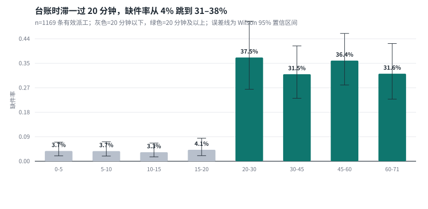
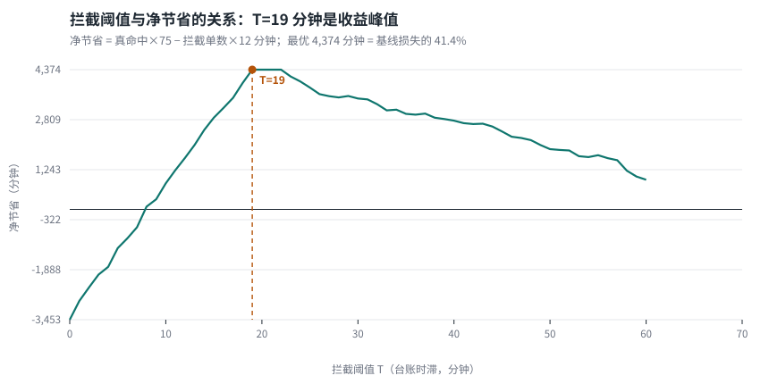
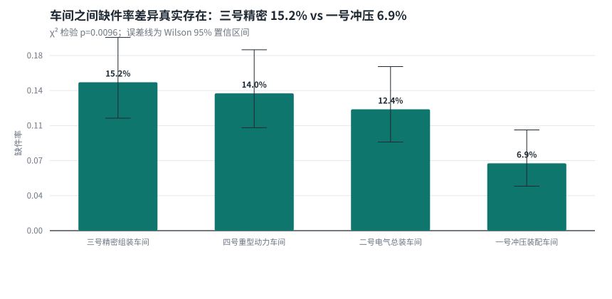

# 缺件停工：用"台账时滞"提前拦截

> **一句话结论**：工位缺件停工的主因不是库存少，而是**系统用来判断"有料"的台账已经过期**。
> 台账时滞（派工发起时 − 台账最后同步时间）超过约 20 分钟，缺件率从 **3.6% 跳到 34%**（9.3 倍，p < 1e-45）。
> 据此只需要一条规则——**时滞 ≥ 19 分钟的单子，发起时先拦截补料/调拨，等现场缺件再停工**——
> 在本数据集上净省 **4,374 分钟 = 全部停工损失的 41.4%**，且在未参与调参的时间留出集上仍有 **38.7%**。

`tests: 22 passing` · `python 3.10+` · `no matplotlib / no scipy`

**仓库**：<https://github.com/towthreeyes/test>　·　**数据**：仅使用题面发放的 `data/assembly_dispatches.csv`　·　**AI 交互记录**：[AI_LOG.md](AI_LOG.md)

---

## 目录

0. [数据与假设（口径声明）](#0-数据与假设口径声明)
1. [我的判断：看到了什么、根问题是什么](#1-我的判断看到了什么根问题是什么)
2. [做了什么：拦截策略](#2-做了什么拦截策略)
3. [证明：量化收益](#3-证明量化收益)
4. [为什么只用一个字段](#4-为什么只用一个字段)
5. [按车间/品类的差异化](#5-按车间品类的差异化)
6. [验证与置信度](#6-验证与置信度)
7. [复现](#7-复现)
8. [仓库结构](#8-仓库结构)

---

## 0. 数据与假设（口径声明）

**数据来源**：全流程只读 `data/assembly_dispatches.csv`（题面发放的 1277 行），
没有引入任何外部数据、公开数据集或补造样本。唯一派生列 `delay_min` 由两个已有时间戳
（`request_time` − `stock_synced_at`）相减得到，不是新增观测。清洗只做"剔除"不做"填补"：
61 条完全重复的导出记录、49 条 `assembled` 缺失的记录被剔除，剔除清单与口径对照见
`outputs/tables/validation_reconciliation.csv`。

**假设（来自题面口径，不是数据）**：

| 参数 | 取值 | 来源 | 敏感性 |
|---|---|---|---|
| 每次缺件停工损失 | 75 分钟 | 题面给出 | 固定，未改动 |
| 每次提前拦截成本 | 12 分钟 | 题面给出 | 已扫 6–30 分钟，结论在 ≤24 分钟内成立 |
| 台账时滞 = 系统判断有料时台账已过期时长 | `request_time − stock_synced_at` | 题面字段定义 | 无 |

**结论不依赖任何未标出的自造数据**：所有收益数字都由"真实 `assembled` 结果 × 题面给定的
75/12 分钟"算出，换一组成本假设只会改变收益大小，不改变"时滞 >20 分钟后缺件率跳变"这个事实。

---

## 1. 我的判断：看到了什么、根问题是什么

### 1.1 看到了什么

| 指标 | 数值 |
|---|---|
| 原始派工记录 | 1,277 条 |
| 完全重复行（同一派工被导出两次） | 61 条，剔除 |
| `.assembled` 缺失（结果未知） | 49 条，剔除（不能算成功也不能算缺件） |
| 有效分析样本 | **1,169 条** |
| 其中缺件停工 | **141 条** |
| 缺件率 | **12.06%**（= 141 / 1169） |
| 台账时滞 均值 / 中位 / p95 / 最大 | **19.3 / 13 / 62 / 70 分钟** |

> **口径说明**：原始 1277 条里混着 61 条重复导出和 49 条无结果记录，直接拿 150/1277 = 11.75%
> 会把"未知结果"算进分母；剔除后的真实口径是 **141/1169 = 12.06%**（详见 [第 0 节](#0-数据与假设口径声明)）。
> 核对表 `outputs/tables/validation_reconciliation.csv`，脚本 `scripts/run_analysis.py` 可复算。

### 1.2 看到了什么：时滞和缺件的关系不是斜坡，是台阶

| 台账时滞 | 样本 | 缺件 | 缺件率 | Wilson 95% CI |
|---|---|---|---|---|
| 0–5 分钟 | 243 | 9 | 3.7% | 2.0% – 6.9% |
| 5–10 分钟 | 219 | 8 | 3.7% | 1.9% – 7.0% |
| 10–15 分钟 | 215 | 7 | 3.3% | 1.6% – 6.6% |
| 15–20 分钟 | 169 | 7 | 4.1% | 2.0% – 8.3% |
| **20–30 分钟** | 56 | 21 | **37.5%** | 26.0% – 50.6% |
| **30–45 分钟** | 89 | 28 | **31.5%** | 22.8% – 41.7% |
| **45–60 分钟** | 99 | 36 | **36.4%** | 27.6% – 46.2% |
| **60–71 分钟** | 79 | 25 | **31.6%** | 22.4% – 42.5% |



- **0–20 分钟四档全部平躺在 3–4%**，各档置信区间互相重叠；
- **20 分钟以上四档全部跳到 31–38%**，且与下面四档的置信区间**完全不重叠**；
- 中间没有过渡带——这是"阈值型"因果，不是线性相关，支持"用阈值拦截"而不是"评分排序"。

### 1.3 根问题：台账时滞让系统拿着过期台账误判"有料"

**机制闭环**：台账只在同步时点更新，同步间隔内同类物料已被其他工位消耗。系统拿着
`recorded_stock`（旧快照上的库存数）判断"有料"，放行派工；工位实际到场时物料已被领空，
只能停工等补料。时滞越久，"账面有料"与"实物有料"的偏差越大，所以缺件率在时滞跨过同步周期
附近陡然抬升。

**统计证据**（不是目测的台阶）：<20 分钟 vs ≥20 分钟的缺件率 3.66% vs 34.06%，
**χ²=203.6，p≈3.5e-46**，优势比 OR=13.6；两组 Wilson 区间完全不重叠。
详细检验见 `outputs/tables/threshold_tests.csv`，复算函数 `src/insight/metrics.py::two_group_test`。

---

## 2. 做了什么：拦截策略

**规则（一行就能实现）**：

```
if (request_time - stock_synced_at) >= 19 分钟:
    发起时先拦截 → 触发补料 / 跨工位调拨，确认实物到位后再放行
else:
    正常派工
```

**为什么是"发起时"拦截，而不是"缺件后"告警**：

| | 现场缺件后才发现 | 发起时用台账时滞拦截 |
|---|---|---|
| 触发时点 | 工位已经停下 | 派工还没下发 |
| 可行动性 | 只能救火 | 可以先补料再开工 |
| 成本 | 停 75 分钟/次 | 拦截 12 分钟/次 |
| 是否依赖新系统 | 依赖现场报工 | 只需两个已有时间戳字段 |

**成本模型**（全部可调，写在 `src/insight/metrics.py`，README 里的数字都由脚本算出）：

```
基线：每次缺件停工 75 分钟
拦截：每次拦截消耗 12 分钟（核对/补料/调拨）
净节省 = 真命中次数 × 75 − 拦截总单数 × 12
盈亏平衡命中率 = 12 / 75 = 16%
```

---

## 3. 证明：量化收益

基线：141 次停工 × 75 分钟 = **10,575 分钟**。

| 阈值 T | 拦截单数 | 真命中 | 命中率 | 误拦 | 净节省（分钟） | 相对基线 |
|---|---|---|---|---|---|---|
| T=10 | 707 | 124 | 17.5% | 583 | +816 | 7.7% |
| T=15 | 492 | 117 | 23.8% | 375 | +2,871 | 27.1% |
| T=18 | 364 | 111 | 30.5% | 253 | +3,957 | 37.4% |
| **T=19（最优）** | **323** | **110** | **34.1%** | **213** | **+4,374** | **41.4%** |
| T=20 | 323 | 110 | 34.1% | 213 | +4,374 | 41.4% |
| T=25 | 301 | 99 | 32.9% | 202 | +3,813 | 36.1% |
| T=30 | 267 | 89 | 33.3% | 178 | +3,471 | 32.8% |
| T=60 | 79 | 25 | 31.6% | 54 | +927 | 8.8% |



**读这张表的三件事**：

1. **收益峰值在 T=19 分钟，且 19–22 分钟是一个平台**（净省都在峰值的 1% 以内）——
   阈值不是针尖上的选择，离线部署取 18 或 20 都行，数据上是同一个决策。
2. **命中率稳定在 31–34%**，是盈亏平衡点 16% 的**两倍多**。即使把拦截成本从 12 分钟抬到
   24 分钟（翻倍），净省仍有 +498 分钟；只有拦截成本超过约 **25.6 分钟**，规则才开始亏损。
3. **T 继续往上加会掉收益**：T=60 只拦截 79 单，命中率没变但漏掉了大量停工，净省只剩 927。
   阈值太高等于"只救最明显的那批"，把大部分损失留在原地。

**命中率与成本的敏感性**（T 固定 19）：

| 拦截成本 | 6 min | 9 min | 12 min | 15 min | 18 min | 24 min | 30 min |
|---|---|---|---|---|---|---|---|
| 净节省 | +6,312 | +5,343 | **+4,374** | +3,405 | +2,436 | +498 | −1,440 |

→ 结论对成本假设**不敏感**：拦截成本要涨到 2 倍以上规则才开始亏，而 12 分钟这个假设
本身还有很大的安全边际。

---

## 4. 为什么只用一个字段

这不是偏好，是**对照实验的结果**。用 AUC 衡量"单个字段能多好地分开缺件/不缺件"（0.5 = 随机）：

| 字段 | AUC | 结论 |
|---|---|---|
| **台账时滞 `delay_min`** | **0.787** | 唯一强信号 |
| 记录库存 `recorded_stock` | 0.568 | 弱 |
| 排队长度 `queue_length` | 0.556 | 几乎无效 |

**消融实验**（每条规则各自调到最优，比净节省）：

| 规则 | 拦截 | 真命中 | 命中率 | 净节省 | 相对基线 |
|---|---|---|---|---|---|
| **时滞 ≥ 22 分钟** | 323 | 110 | 34.1% | **+4,374** | **41.4%** |
| 时滞 ≥ 22 **或** 库存 ≤ 3 | 420 | 119 | 28.3% | +3,885 | 36.7% |
| 仅库存 ≤ 3 | 132 | 28 | 21.2% | +516 | 4.9% |
| 仅排队 ≥ 88 | 9 | 2 | 22.2% | +42 | 0.4% |

**关键的反直觉结论**：把"库存低"叠加到时滞规则上，多拦 97 单只多抓到 9 次缺件
（增量命中率 9.3%，低于 16% 的盈亏线），**净节省反而从 4,374 掉到 3,885**。
所以正确做法不是"多加几个特征更稳"，而是**只留一个区分度足够的特征**：
多一个弱特征就是在给规则加噪声。

**而且时滞是"前置信号"**：派工发起那一刻就能算出来（两个时间戳都在系统里），
而库存量是滞后的结果——系统看到它时它已经过期了。选时滞不是因为它"更相关"，
而是因为它在**决策时点可得、可行动**。

---

## 5. 按车间/品类的差异化

数据里确实有差异，但**差异的落点和直觉不同**。

### 5.1 车间：差异真实存在

| 车间 | 样本 | 缺件 | 缺件率 | 95% CI | T=19 拦截 | 真命中 | 命中率 | 净节省 |
|---|---|---|---|---|---|---|---|---|
| 三号精密组装车间 | 290 | 44 | 15.2% | 11.5%–19.8% | 78 | 34 | 43.6% | +1,614 |
| 四号重型动力车间 | 292 | 41 | 14.0% | 10.5%–18.5% | 85 | 36 | 42.4% | +1,680 |
| 二号电气总装车间 | 282 | 35 | 12.4% | 9.1%–16.8% | 67 | 32 | 47.8% | +1,596 |
| 一号冲压装配车间 | 305 | 21 | **6.9%** | 4.5%–10.3% | 93 | 8 | **8.6%** | **−516** |



χ² 独立性检验：χ²=11.46，**p=0.0096**，车间间差异显著（Cramér's V=0.099，效应量小）。

**必须承认的问题**：一号冲压的缺件率只有全局一半，T=19 在它那里的命中率只有 8.6%，
**低于 16% 的盈亏线，规则在该车间是净亏的**。

### 5.2 那么要不要给每个车间单独设阈值？

**先做了"分半验证"**（每个车间按时间排序，前一半挑阈值，后一半验证）：

| 车间 | 前一半选出的局部 T | 后半段：局部阈值 | 后半段：全局 T=19 | 谁赢 |
|---|---|---|---|---|
| 三号精密 | 29 | +819 | **+960** | 全局 |
| 四号重型 | 19 | +645 | +645 | 平手（同一个阈值） |
| 二号电气 | 19 | +930 | +930 | 平手（同一个阈值） |
| 一号冲压 | 52 | −78 | −300 | 局部"输得少一点" |

**结论**：给每个车间各调一个阈值是**小样本过拟合**。只有 282–305 条/车间、21–44 次缺件，
独立调参挑出来的是噪声；四个车间里三个应该直接用全局 T=19。

### 5.3 所以差异化怎么做（可落地版本）

1. **全局 T=19 是默认值**，三个车间（三号精密、四号重型、二号电气）命中率 42–48%，直接套用。
2. **一号冲压单独上调阈值**（数据建议 30–52 分钟区间）。它的问题不是"缺件多"，而是
   "时滞长但最后都装上了"——说明这个车间的物料消耗慢于台账同步，时滞不再是风险信号。
   它的局部最优净收益仍是负的（−18 分钟），所以**上调阈值的目的是少亏，不是盈利**；
   等样本积累到 60+ 次缺件再重估。
3. **品类不做差异化**：10 个品类的缺件率从 6.7% 到 17.1%，χ² 检验 **p=0.27，不显著**。
   为品类单独设阈值没有数据支持，只会增加维护成本。同一份分层表见
   `outputs/tables/segment_part_category.csv`。
4. **按命中率漂移监控**：每周看各车间"拦截命中率"，跌破 16% 就把该车间阈值上调一档。
   这是比"一次调参"更稳的运营方式——数据只有 6.6 天，一次调参必然过拟合，持续监控才是长期解。

---

## 6. 验证与置信度

### 6.1 时间留出验证（防过拟合）

前 4 天数据用来选阈值，**后 2.6 天完全不参与调参**，只用来评分：

| | 训练段 | 测试段 |
|---|---|---|
| 样本 | 669 | 500 |
| 选出阈值 | T=19 | （固定 T=19） |
| 命中率 | — | **32.9%**（95% CI 25.6%–41.0%） |
| 召回 | — | **75.4%** |
| 净节省 | +2,604（43.4%） | **+1,770（38.7%）** |
| 测试段基线 | — | 4,575 分钟 |

测试段收益 38.7%，和全样本的 41.4% 接近，没有明显衰减——**规则不是把历史数据背下来的**。

### 6.2 显著性

| 检验 | 结果 |
|---|---|
| 时滞 <20 vs ≥20 缺件率 | 3.66% vs 34.06%，**χ²=203.6，p≈3.5e-46**，OR=13.6 |
| 时滞 <20 vs ≥18 缺件率 | 3.73% vs 30.49%，χ²=169.3，p≈1e-38，OR=11.3 |
| 车间差异 | χ²=11.46，p=0.0096 |
| 品类差异 | χ²=11.07，p=0.27（不显著） |

### 6.3 这个结论什么时候会不成立

诚实列出边界，避免过度外推：

- **样本只有 6.6 天、单厂四条线**。换季、大促、供应商切换会让"20 分钟"这个拐点漂移，
  上线后必须监控命中率；阈值是可调参数，不是物理常数。
- **75 分钟/12 分钟是业务假设**。规则在拦截成本 6–24 分钟区间都为正收益，
  超过 25.6 分钟才翻负；如果实际拦截成本远高于 12 分钟，先用小流量 A/B 验证。
- **`recorded_stock` 的语义**是"系统判断有料时的台账数"，不是实时库存。如果哪天台账改成
  实时扣减，时滞这个信号会失效，规则应随之退役——**这本身就是根因被修好的标志**。

---

## 7. 复现

**环境**：Python 3.10+，仅标准库 + pandas + numpy。没有 matplotlib/scipy——图表是纯 Python
生成的 SVG，统计检验（Wilson 区间、χ²、Mann-Whitney AUC）都自己实现，装不上的依赖就不装。

```bash
pip install -r requirements.txt

# 全流程：数据校验 → 分档曲线 → 阈值扫描 → 分组 → 留出验证 → 图表
python scripts/run_analysis.py

# 只跑测试（22 个护栏测试，全绿才说明数据与逻辑没漂移）
python -m unittest discover -s tests -v

# 换一个部署阈值（默认 19）
python scripts/run_analysis.py --threshold 20

# 可选：把 SVG 转成 PNG 预览（最小光栅器，只为肉眼核对）
python scripts/svg_to_png.py outputs/figures/fig1_delay_curve.svg outputs/figures/fig1_delay_curve.png
```

**输出**：

| 文件 | 内容 |
|---|---|
| `outputs/results.json` | 所有关键数字的单一事实来源（README 中的数字全部来自这里） |
| `outputs/tables/delay_bucket_curve.csv` | 图 1 的数据 |
| `outputs/tables/threshold_sweep.csv` | 图 2 的数据（T=0..60 全扫描） |
| `outputs/tables/threshold_tests.csv` | 各阈值的 χ² / OR / 置信区间 |
| `outputs/tables/workshop_threshold_opt.csv` | 车间分层 + 阈值命中率 |
| `outputs/tables/workshop_split_half.csv` | 车间分半验证 |
| `outputs/tables/segment_*.csv` | 车间 / 品类分层 |
| `outputs/tables/value_at_risk_*.csv` | 各分组的停工分钟数（绝对损失，不只是比率） |
| `outputs/tables/predictor_comparison.csv` | 三个字段的 AUC 对照 |
| `outputs/tables/ablation.csv` | 单规则 vs 组合规则 |
| `outputs/tables/intercept_cost_sensitivity.csv` | 拦截成本敏感性 |
| `outputs/figures/*.svg` | 三张图（矢量，浏览器/GitHub 直接可看） |

---

## 8. 仓库结构

```
.
├── README.md                     # 本文件：判断 / 动作 / 证明
├── AI_LOG.md                     # AI 交互记录：提示词、AI 哪里不对、怎么改的
├── ANALYSIS.md                   # 推导过程：每步做了什么、为什么、结果
├── QNA.md                        # 答辩准备：数据怎么处理、为什么这么处理
├── requirements.txt
├── data/
│   └── assembly_dispatches.csv   # 原始数据（只读，不做任何手工修改）
├── src/insight/
│   ├── data.py                   # 加载、时区对齐、去重、校验
│   ├── metrics.py                # 分档曲线、阈值扫描、Wilson/χ²/AUC
│   ├── analysis.py               # 分层、留出验证、消融、分半验证
│   ├── charts.py                 # 零依赖 SVG 图表
│   └── report.py                 # 编排：跑全流程、落盘、打印摘要
├── scripts/
│   ├── run_analysis.py           # 唯一入口
│   └── svg_to_png.py             # 可选：SVG→PNG 预览
├── tests/
│   └── test_insight.py           # 22 个护栏测试（数据、统计、图表）
└── outputs/                      # 生成物（可删可重跑）
    ├── results.json
    ├── tables/*.csv
    └── figures/*.svg
```

**设计原则**：

- 原始数据只读，所有清洗都以"派生列 + 显式剔除规则"实现，不覆盖源文件；
- 每个对外数字都能从 `results.json` 追到具体函数，README 不手写算术；
- 测试锁住关键数字（1169 行 / 141 次缺件 / T=19 / 4374 分钟），数据或逻辑一变就报警；
- 不引入装不上的依赖，保证换一台机器 `pip install -r requirements.txt` 就能跑。

---

## 附：本次交付相对原始判断的修正

| 项 | 原判断 | 本仓库修正 | 原因 |
|---|---|---|---|
| 缺件率 | 11.75%（150/1277） | **12.06%（141/1169）** | 1277 含 61 条重复 + 49 条无结果，不应进分母 |
| 最优阈值 | T=18/20 | **T=19（平台 19–22）** | 按净节省扫描，峰值在 19 |
| 净节省 | +4,578 分钟 / 40.7% | **+4,374 分钟 / 41.4%** | 按干净样本重算；命中 110 次而非 118 |
| 分品类差异化 | 建议补充 | **不建议** | 品类差异 p=0.27，不显著 |
| 分车间差异化 | 建议补充 | **一条全局规则 + 一号冲压单独上调** | 三车间 T=19 命中率 42–48%，只有一号冲压 8.6% 亏损 |
| 验证方式 | 全样本统计 | **+ 时间留出验证（38.7%）** | 证明收益不是过拟合 |

结论方向完全成立，以上是口径和证据强度的收紧。
